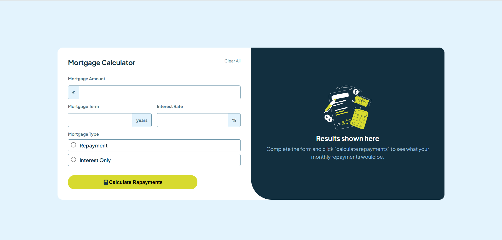
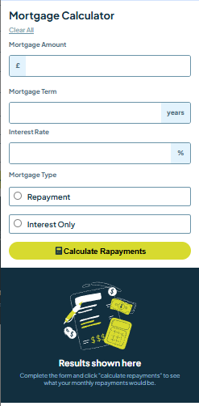

# Frontend Mentor - Solução para a calculadora de amortização de hipoteca

Esta é uma solução para o [desafio da calculadora de amortização de hipoteca no Frontend Mentor](https://www.frontendmentor.io/challenges/mortgage-repayment-calculator-Galx1LXK73). Os desafios do Frontend Mentor ajudam você a aprimorar suas habilidades de programação através da criação de projetos realistas.

## Visão geral
Desenvolvi esse projeto com o objetivo de aprimorar minhas habilidades com flexbox e JavaScript basico.
    
### Captura de tela

**Abaixo o projeto para Desktop** 

**Abaixo o projeto para Mobile**

### Site

- URL do site no ar: [Projeto](https://mario-calebe.github.io/projeto-hipoteca/)

### Construído com

- Marcação HTML5 semântica
- Propriedades personalizadas de CSS
- Flexbox
- Fluxo de trabalho mobile-first

### O que aprendi

- Manipulação de dados
- Validação de dados
- Aria para acessibilidade

## Relatorio

Com base ao frontend mentor eu tive uma melhor noção do que é ser um progamador.
Nos meus futuros projetos tenho que buscar um melhor *readme.md* e *.gitignore*, melhorar na parte semântica do HTML
e em melhores usos para **Id e Class**, melhorar os commits, principalmente os de versões finais do projeto.

